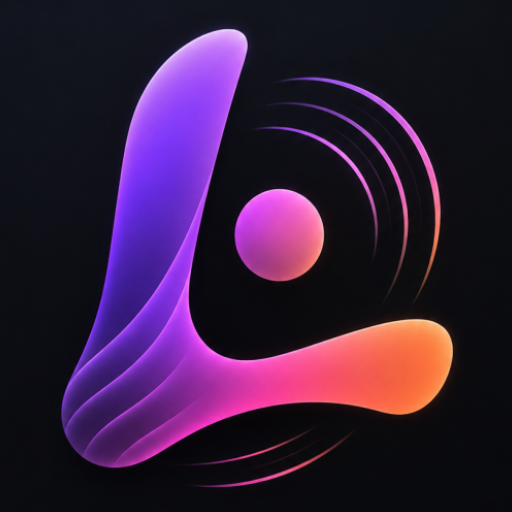
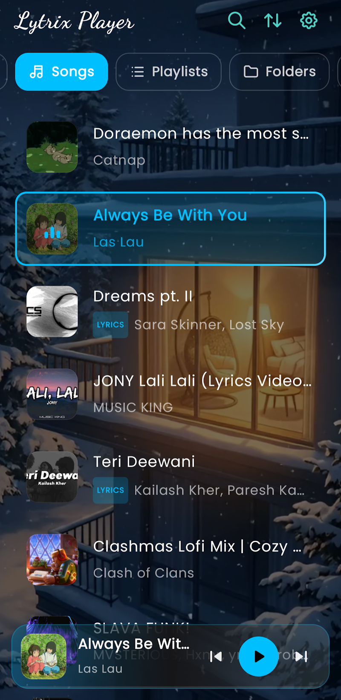
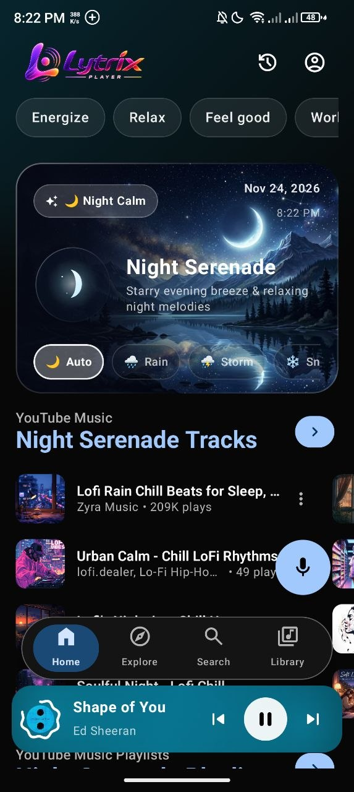
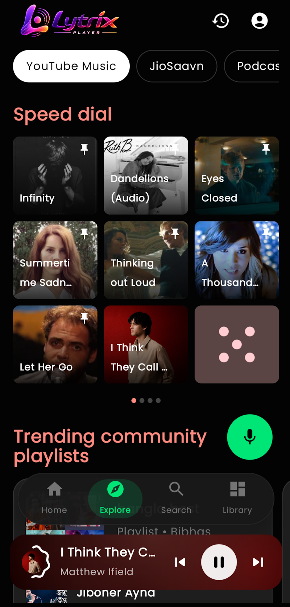
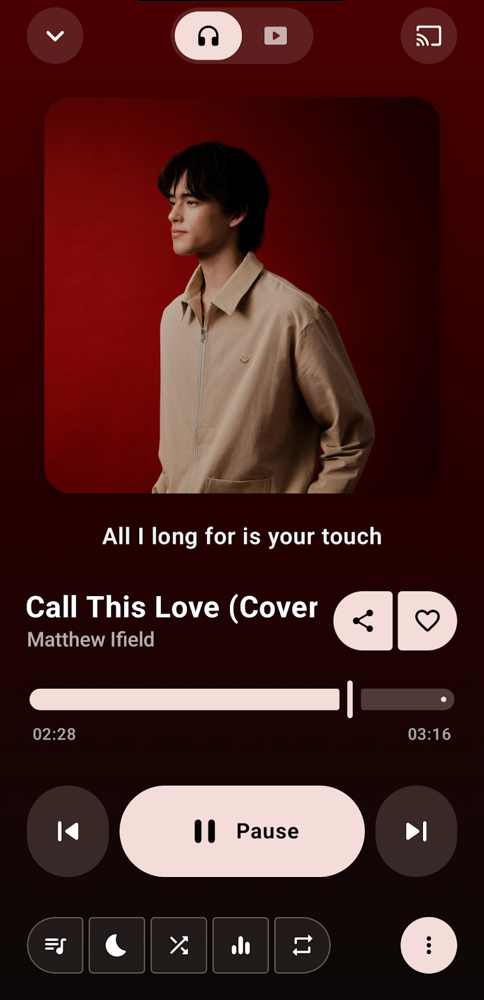
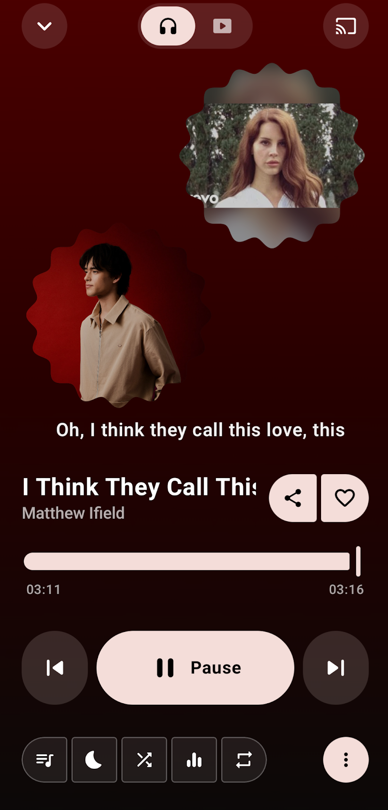
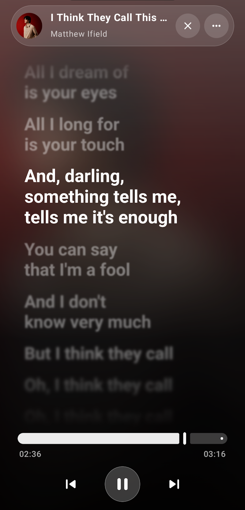
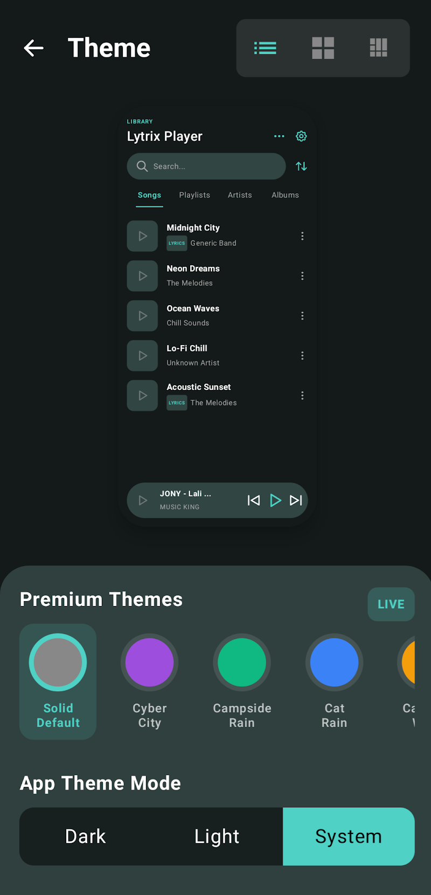

# 🎵 Lytrix Player

<div align="center">



### *An elegant, high-performance Material 3 Music & Video Player for Android.*

[](https://github.com/shuvro-10/lytrix-player/releases)
[](LICENSE)
[](https://www.android.com/)
[](https://kotlinlang.org)
[](https://developer.android.com/compose)
[](https://m3.material.io/)

[**📥 Download Latest APK**](https://github.com/shuvro-10/lytrix-player/releases/latest) • [**✨ Features**](#key-features) • [**📱 Screenshots**](#screenshots) • [**🛠️ Build Guide**](#building-from-source) • [**🙏 Credits**](#credits)

</div>

---

<a id="key-features"></a>
## 🌟 Key Features

### 🎧 Dual-Source Online Music Streaming
* **YouTube Music & JioSaavn Unified:** Explore millions of tracks, trending charts, playlists, and albums with lossless high-fidelity audio (up to **320 kbps**).
* **Smart Music Discovery:** Personalized home feeds, genre radio, mood categories, and artist spotlights powered by InnerTube.
* **Ad-Free & Unlimited:** Uninterrupted background playback with zero audio advertisements or subscription paywalls.

### 👥 Listen Together (Real-Time Sync)
* **Sync Rooms:** Create private listening rooms or join friends using room codes.
* **Millisecond Audio Sync:** Listen to the same song at the exact same millisecond with built-in clock synchronization and peer controls.
* **In-Room Chat & Queue Sharing:** Dynamic communal queue where everyone can add, reorder, or vote on songs.

### 📝 Synchronized Real-Time Lyrics
* **Multi-Provider Aggregation:** Powered by LRCLIB, KuGou, Musixmatch, and BetterLyrics.
* **Syllable & Word-by-Word Sync:** Beautiful karaoke-style scrolling lyrics with glowing active lines.
* **Translation & Romanization:** Real-time translation and romanization for Japanese, Korean, Hindi, and regional tracks.
* **Offline Lyrics Caching:** Cached lyrics remain accessible offline without internet connectivity.

### 🎨 Material 3 Expressive Design
* **Dynamic Palette Extraction:** Player colors seamlessly morph and blend with the currently playing track's artwork.
* **Switchable Player Styles:**
  * 🍏 **Apple Music Style:** Fluid vertical scrolling lyrics, vibrant blurred backgrounds, and subtle haptics.
  * 💽 **Vinyl Turntable:** Realistic spinning record animation with needle engagement.
  * 📻 **Retro Cassette Deck:** Nostalgic tape reels with spinning spools.
  * 🌊 **Waveform & Spectrum Visualizer:** Real-time audio frequency visualizers.
* **Homescreen Widgets:** Sleek interactive widgets for your home screen (Capsule Deck, Mini Vinyl, Quick Play).
* **Always-On Display (AOD):** Deep-black OLED ambient display mode showing the clock, track title, and media controls.

### 🎛️ Audiophile Sound Engine
* **10-Band Graphic Equalizer:** Precision tuning with rich genre presets (Bass Boost, Vocal, Rock, Electronic, Flat).
* **Audio FX:** Bass Booster, Virtualizer / Surround Sound, and Loudness Enhancer.
* **Playback Speed & Pitch:** Variable speed (0.5x – 2.0x) and independent semitone pitch adjustment.
* **Gapless Playback & Crossfade:** Zero silence between tracks for live albums and DJ mixes.
* **Sleep Timer & Music Alarms:** Drift off to gentle music with smooth volume fade-out.

### 💾 Local Library & Offline Downloads
* **Complete Format Support:** Play local MP3, FLAC, M4A, AAC, Opus, OGG, and WAV with embedded tag parsing.
* **High-Speed Caching:** Download songs with full album art, artist tags, and embedded lyrics for offline road trips.
* **Smart Library Organization:** Browse by Songs, Folders, Albums, Artists, and Custom Playlists.

---

<a id="screenshots"></a>
## 📱 Screenshots

<div align="center">

| Local Library | Smart Home Feed | Speed Dial & Quick Picks | Now Playing (M3) |
| :---: | :---: | :---: | :---: |
|  |  |  |  |

<br/>

| Canvas & Turntable | Synchronized Lyrics | Dynamic Themes & Visualizer |
| :---: | :---: | :---: |
|  |  |  |

</div>

---

## 🏗️ Architecture & Technology Stack

| Layer | Technologies |
|---|---|
| **Language** | Kotlin 2.0+ (100% Coroutines & Flow) |
| **UI Framework** | Jetpack Compose, Material 3 Expressive, Compose Animations |
| **Media Engine** | AndroidX Media3 (ExoPlayer) + Custom Audio Processors |
| **Local Database** | AndroidX Room Database with SQLite (Encrypted / Clean Schema) |
| **Networking** | OkHttp 4, Retrofit 2, Kotlin Serialization, WebSockets |
| **Image Pipeline** | Coil 2 with Hardware Bitmap Caching & Palette Extraction |
| **Architecture** | Modern Android Architecture (MVVM, StateFlow, Unidirectional Data Flow) |

---

<a id="building-from-source"></a>
## 🛠️ Building from Source

### Prerequisites
* **Android Studio:** Ladybug (2024.2+) or newer
* **JDK:** Version 17 or higher
* **Android SDK:** API 35 (Android 15) compile target

### Build Instructions

1. **Clone the repository:**
   ```bash
   git clone https://github.com/shuvro-10/lytrix-player.git
   cd lytrix-player
   ```

2. **Setup Google Services configuration:**
   ```bash
   cp app/google-services.json.example app/google-services.json
   ```
   *(Ensure your `google-services.json` has your package configuration if compiling with custom push features).*

3. **Build the Debug APK:**
   ```bash
   ./gradlew assembleDebug
   ```
   The generated APK will be available in:
   `app/build/outputs/apk/debug/app-debug.apk`

---

<a id="credits"></a>
## 🙏 Acknowledgments & Credits

Lytrix Player stands on the shoulders of giants. We express our heartfelt gratitude to the remarkable open-source projects, authors, and communities whose work inspired, contributed to, or is utilized within this project:

- **[Metrolist](https://github.com/vfsfitvnm/ViMusic)** (by [@vfsfitvnm](https://github.com/vfsfitvnm) and contributors)  
  *Pioneering YouTube Music client integration, playback controller architecture, database schema concepts, and Material vector icon sets under GPL-3.0.*

- **[NewPipe / NewPipeExtractor](https://github.com/TeamNewPipe/NewPipeExtractor)** (by Team NewPipe)  
  *Pioneering YouTube media stream extraction algorithms, audio stream deciphering, and video format parsing under GPL-3.0.*

- **[Meld](https://github.com/)**  
  *Inspiration for fluid player animations, tactile physics, gesture-driven bottom sheets, and responsive now-playing layout paradigms.*

- **[InnerTube & SimpMusic](https://github.com/maxrave-dev/SimpMusic)** (by [@maxrave-dev](https://github.com/maxrave-dev) and contributors)  
  *InnerTube API reverse-engineering models, request parsing, and multi-source synchronized lyrics providers (LRCLIB, KuGou, Musixmatch, BetterLyrics) under GPL-3.0.*

- **[AndroidX Media3 / ExoPlayer](https://github.com/androidx/media)** (by Google)  
  *The industry-standard media playback and audio pipeline foundation.*

- **[Material Design 3 Expressive](https://m3.material.io/)** (by Google)  
  *Expressive component design system, dynamic color theming, and motion guidelines.*

---

## 📄 License

Lytrix Player is free and open-source software licensed under the **GNU General Public License v3.0 (GPL-3.0)**.  
See the [LICENSE](LICENSE) file for the full license text.

```text
Lytrix Player
Copyright (C) 2026 Shuvro (shuvro-10) & Lytrix Contributors

This program is free software: you can redistribute it and/or modify
it under the terms of the GNU General Public License as published by
the Free Software Foundation, either version 3 of the License, or
(at your option) any later version.

This program is distributed in the hope that it will be useful,
but WITHOUT ANY WARRANTY; without even the implied warranty of
MERCHANTABILITY or FITNESS FOR A PARTICULAR PURPOSE.  See the
GNU General Public License for more details.
```
